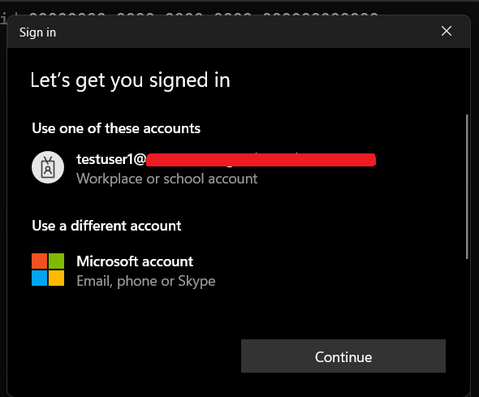
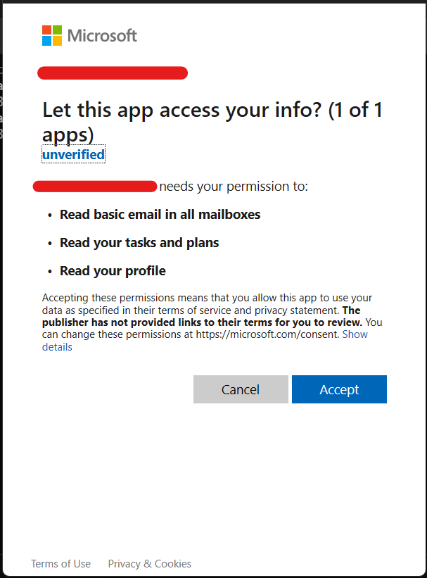

# WAM CLI

- [WAM CLI](#wam-cli)
  - [Overview](#overview)
  - [Key Features](#key-features)
  - [Installation](#installation)
  - [Upgrading](#upgrading)
  - [Usage](#usage)
  - [Getting Started](#getting-started)
    - [Sample launchSettings.json](#sample-launchsettingsjson)
  - [References](#references)

## Overview

WAM CLI is a command-line tool for generating access tokens using the Microsoft Authentication Library (MSAL) and the Web Account Manager (WAM) broker. It simplifies authentication for scripts and applications by centralizing token generation, supporting both silent and interactive flows.

## Key Features

- Support for single and multi tenancy app registrations
- Simplifies authentication by handling token caching and interactive logins
- Outputs tokens in JSON format for easy integration with scripts

## Installation

To install the tool globally, use the command below:

```bash
dotnet tool install --global milkyware-wam-cli
```

## Upgrading

When an update becomes available, the tool can be upgraded using `dotnet tool update`:

```bash
dotnet tool update --global milkyware-wam-cli
```

## Usage

The cli has the `--help` option available to display examples as well as documentation for the options available:

```bash
milkyware-wam-cli --help
```

Running the cli with `--help` displays the below:

```bash
USAGE:
    milkyware-wam-cli [OPTIONS]

EXAMPLES:
    milkyware-wam-cli -c 00000000-0000-0000-0000-000000000000
    milkyware-wam-cli -c 00000000-0000-0000-0000-000000000000 -t 00000000-0000-0000-0000-000000000000
    milkyware-wam-cli -c 00000000-0000-0000-0000-000000000000 -s User.Read -s Mail.Read
    milkyware-wam-cli -c 00000000-0000-0000-0000-000000000000 --clear-cache

OPTIONS:
    -h, --help              Prints help information
        --debug             Increase logging verbosity to show all debug logs
        --clear-cache       Clear the token cache before acquiring a new token
    -c, --client-id         Required. The client ID of the app reg
    -s, --scope <VALUES>    Optional. The scopes required for the token. Defaults to User.Read
    -t, --tenant-id         Optional. The tenant ID of the single tenancy App Reg
```

The Cli supports **both single-tenancy and multi-tenancy (inc. personal accounts)** configured app registrations to generate tokens.

```bash
milkyware-wam-cli --client-id 00000000-0000-0000-0000-000000000000
```

Running the above command (with a multi-tenancy enabled) app reg client id will firstly attempt to **silently acquire** a token from the cache. If a token is not found, the interactive WAM prompt will then be displayed.



The WAM broker displays **windows connected** accounts to login with.



If the account hasn't authorised with the app reg before, or the requested permissions have changed, the user will also be asked to accept the permissions.

```json
{
  "accesstoken": "access-token-value"
}
```

Lastly, the Cli returns a JSON object containing the token. This can then easily be de-serialized, such as `ConvertFrom-Json` in PowerShell, and attached to Graph API requests.

## Getting Started

### Sample launchSettings.json

The **launchSettings.json** file is ignored from the repo to avoid IDs being committed. Below is a sample of launch configurations to allow debugging the app. Any of the available arguments and options can be configured in the `commandLineArgs` property:

```json
{
  "profiles": {
    "MilkyWare.Wam.Cli": {
      "commandName": "Project",
      "commandLineArgs": "-c 00000000-0000-0000-0000-000000000000"
    }
  }
}
```

## References

- [Spectre.Console](https://spectreconsole.net/)
- [MSAL WAM Broker](https://learn.microsoft.com/en-us/entra/msal/dotnet/acquiring-tokens/desktop-mobile/wam)
- [MS Identity Sample Repo](https://github.com/Azure-Samples/ms-identity-dotnet-desktop-tutorial)
